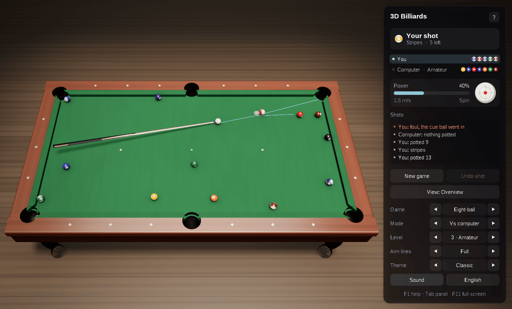
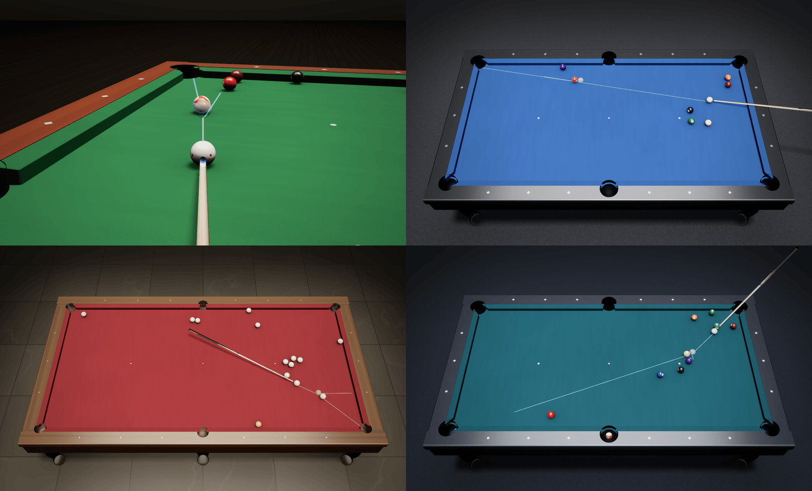

# 3D Billiards — C++23, Win32 and OpenGL 4.6

[](https://github.com/sponsors/makarov-mm)
[](LICENSE)


[](https://www.linkedin.com/in/makarov-mm/)
[](https://www.threads.net/@m.m.makarov)
[](https://www.instagram.com/m.m.makarov/)

A 3D billiards game for Windows written in modern C++ on plain Win32 and OpenGL 4.6: eight-ball and nine-ball on a pool table, and the Russian game «Американка» on a pyramid table.

There is no game engine, framework or third-party library, and no model, texture or sound file: the table, the cushions, the pockets, the balls and the cue are built in code at startup, the cloth, wood, stone and leather are procedural, the lighting environment is baked on the GPU, and the sounds are synthesized. The shaders are built into the executable, so the game is a single `.exe`.





## Features

### Games

- **Eight-ball** on a 9-foot pool table: the first ball potted after the break gives the shooter a group, solids or stripes; with the group cleared the 8 goes into the pocket called; the 8 potted early or on a foul loses
- **Nine-ball**: the lowest ball on the table must be hit first, and the 9 potted on any fair shot wins
- **«Американка»** (free pyramid) on a 12-foot Russian table with sixteen ivory balls and pockets barely wider than a ball: after the break any ball may be struck at any other, every ball potted on a fair shot counts, the struck one too, and eight balls win; a foul gives one of the offender's balls back to the table
- Fouls: the cue ball pocketed, no ball hit, the wrong ball hit first, no ball reaching a cushion after the contact. Ball in hand behind the head string after a scratch on the break, anywhere after the other fouls
- Practice: one player, no fouls, the cue ball back in hand when it drops

### Physics

- The balls slide and roll on the cloth: where the cue strikes gives follow, draw and side spin, sliding turns into rolling by friction, and spin about the vertical dies away
- Collisions between balls with throw from the friction between them, cushions struck above the ball's middle so that spin bends the rebound, rounded jaws, and pockets with real mouths and facings, the Russian ones much tighter
- An event-driven simulation in double precision: every collision is found at its exact time, so fast balls never pass through each other or a cushion. A break plays out in a couple of milliseconds

### Play

- A computer opponent with five levels, from Novice to Master. For each ball it may strike, each ball it may pot and each pocket it finds the line through the ghost ball and keeps the clear ones; it plays the best of them out on a copy of the table with several speeds and spins, to see where the balls stop and how easy its next shot will be; it tests its choice against its own unsteadiness, and plays safe, or kicks off a cushion, when nothing is likely to go in. Lower levels look at fewer shots and strike less accurately. It thinks in the background, then shows its aim before the stroke
- Play against the computer, two players on one computer, practice, or watch a demo game
- Aim lines worked out by the physics itself: the path of the struck ball to the first ball it meets, the ghost ball, where the ball hit goes and where the cue ball follows. Full, short or off
- Each turn starts aimed at the easiest pot. The aim then follows the mouse; press and pull back to strike, the farther the harder; Shift for fine aim. Or from the keyboard: arrows to turn the aim and set the power, Space to strike
- Spin set by dragging on the ball in the panel, or with `W` `A` `S` `D`; the power with a bar
- Ball in hand by dragging the cue ball; in «Американка» a click picks the ball to strike; the pocket for the 8 is chosen from the aim, or with a click on it
- Undo a shot, the history of the game, and the game in progress and the settings kept between sessions
- Three views: an overview, behind the ball along the aim, and from above. The camera also turns with the right mouse button and zooms with the wheel
- English and Russian interface, chosen from the system language
- Sounds mixed on a thread of their own, so a break is heard ball by ball; full screen, per-monitor DPI awareness, a dark title bar
- No work while nothing moves: the game waits for input instead of drawing the same picture

### Graphics

- Physically based shading: GGX highlights, a clear coat on the balls and the rails, image-based lighting from a procedural room with a lamp over the table
- Soft shadows (PCSS) and the shade of the balls on the cloth
- HDR rendering with 4× MSAA, bloom, ACES tone mapping and vignette
- Pool balls with stripes and numbered circles, the ivory Russian set with an amber cue ball; the numbers come from a font atlas rendered at startup
- The pocket holes in the cloth and the rails are cut by the shaders with alpha to coverage, so their edges stay smooth; leather drop pockets on the pool table, nets on the Russian one
- Animation: the stroke of the cue, the balls dropping into the pockets and lying there in a heap, balls set back on the table fading in, the rack set out ball by ball
- Four themes: Classic (green cloth and mahogany), Tournament (blue cloth, black lacquer and chrome), Club (wine-red cloth, walnut and a stone floor) and Night (teal cloth and glowing sights)
- An interface of frosted-glass panels, sharp at any screen scale

## Controls

| Action | Control |
|---|---|
| Aim at a point | Move the mouse |
| Fine aim | `Shift` + mouse |
| Strike: the farther, the harder | Press and pull back, release; a right click takes the stroke back |
| Pick the ball to strike («Американка»); call the pocket for the 8 | Click the ball / the pocket |
| Place a ball in hand | Drag the cue ball |
| Turn the view | Drag with the right mouse button |
| Zoom | Mouse wheel |
| Strike with the power set | `Space` |
| Power | `↑` / `↓` (`Shift` finer) |
| Turn the aim | `←` / `→` (`Shift` finer) |
| Spin: where the cue strikes | `W` `A` `S` `D`; `X` the middle |
| Next view | `C` (`Shift+C` back); `Home` resets it |
| Aim lines: full, short, off | `G` |
| Undo the shot | `Ctrl+Z`, `Backspace` |
| New game | `N` |
| Next game | `B` (`Shift+B` back) |
| Who plays | `M` (`Shift+M` back) |
| Computer level | `1` … `5` |
| Next theme | `T` (`Shift+T` back) |
| Sound on / off | `V` |
| English / Russian | `L` |
| Show / hide the panel | `Tab` |
| Full screen | `F11`, `Alt+Enter` |
| Help | `F1` |
| Leave full screen | `Esc` |

A new game starts at once when the game is changed, or when practice is turned on or off.

## Requirements

- Windows 10 (version 1703 or later) or Windows 11, x64
- A graphics card and driver with OpenGL 4.6 (4.5 is enough)
- Visual Studio 2026 with the **Desktop development with C++** workload; the project uses the C++23 language standard (`/std:c++23`, or `/std:c++23preview` with MSVC Build Tools older than 14.52)

## Building and running

Open `Billiards3D.slnx` in Visual Studio, choose the **Release | x64** configuration and run the project (`Ctrl+F5`).

From a Developer PowerShell:

```powershell
msbuild Billiards3D.slnx -p:Configuration=Release -p:Platform=x64
.\bin\x64\Release\Billiards3D.exe
```

The Release build links the C++ runtime statically, so `Billiards3D.exe` runs on its own. The settings and the game in progress are kept in `%APPDATA%\Billiards3D\Billiards3D.ini`.

## Project structure

```text
.
├── assets/                Billiards3D.ico
├── shaders/               GLSL shaders, built into the executable as resources
├── src/
│   ├── Main.cpp           entry point
│   ├── App.*              the window, game flow, input and interface
│   ├── Physics.*          the balls on the table: sliding, rolling, spin, collisions, cushions, jaws and pockets
│   ├── Rules.*            the racks, fouls, turns and ends of eight-ball, nine-ball and «Американка»
│   ├── Ai.*               the computer player
│   ├── Prediction.*       the aim lines, played out by the physics
│   ├── TableModel.*       meshes of the table, the cushions, the pockets, the balls and the cue
│   ├── TableView.*        the balls as drawn: dropping into the pockets and lying in them
│   ├── Camera.*           the views and mouse rays
│   ├── Renderer.*         the rendering pipeline
│   ├── Themes.*           materials and lighting of the themes
│   ├── Gl.*               OpenGL context (WGL) and functions
│   ├── Text.*             font atlases and the balls' numbers rendered with GDI
│   ├── UiPainter.*        drawing of the interface
│   ├── Sound.*            synthesized sound effects and their mixer
│   ├── Settings.*         the settings file
│   ├── Strings.*          English and Russian texts
│   ├── Resources.*        access to the resources built into the executable
│   ├── MathTypes.h        vectors and matrices
│   └── Win32.h            windows.h and UTF-8 conversions
├── Billiards3D.rc         the icon, version information and shaders
├── Billiards3D.vcxproj
└── Billiards3D.slnx
```

## How a frame is drawn

1. **Shadow map** — the cushions, the rails, the frame, the cue and the balls seen from the lamp's key light, for soft shadows; the balls in one instanced draw.
2. **Main pass** — the floor, the frame, the cushions, the pockets, the rails and the cloth in HDR with 4× MSAA, lit by the key light and the baked environment. The holes of the pockets are cut in the cloth and the rails by their shader; the spots, the head string, the aim lines and the ring round the pocket called are drawn on the cloth by it too, filtered over each pixel. The balls follow in one instanced draw from a storage buffer, then the cue, the room behind, and the see-through ghost ball last.
3. **Post-processing** — the samples are resolved, bright parts spread into a six-level bloom, and the composite pass applies tone mapping and vignetting and frosts the glass behind the interface panels.
4. **Interface** — panels, text and icons, drawn on top.

The environment maps are baked with compute shaders when the theme changes, and the BRDF table once at startup.

## License

MIT License

Copyright (c) 2026 Mykhailo Makarov

Permission is hereby granted, free of charge, to any person obtaining a copy
of this software and associated documentation files (the "Software"), to deal
in the Software without restriction, including without limitation the rights
to use, copy, modify, merge, publish, distribute, sublicense, and/or sell
copies of the Software, and to permit persons to whom the Software is
furnished to do so, subject to the following conditions:

The above copyright notice and this permission notice shall be included in all
copies or substantial portions of the Software.

THE SOFTWARE IS PROVIDED "AS IS", WITHOUT WARRANTY OF ANY KIND, EXPRESS OR
IMPLIED, INCLUDING BUT NOT LIMITED TO THE WARRANTIES OF MERCHANTABILITY,
FITNESS FOR A PARTICULAR PURPOSE AND NONINFRINGEMENT. IN NO EVENT SHALL THE
AUTHORS OR COPYRIGHT HOLDERS BE LIABLE FOR ANY CLAIM, DAMAGES OR OTHER
LIABILITY, WHETHER IN AN ACTION OF CONTRACT, TORT OR OTHERWISE, ARISING FROM,
OUT OF OR IN CONNECTION WITH THE SOFTWARE OR THE USE OR OTHER DEALINGS IN THE
SOFTWARE.

## Support

If you found this project interesting or useful, you can support my work:

[](https://github.com/sponsors/makarov-mm)
